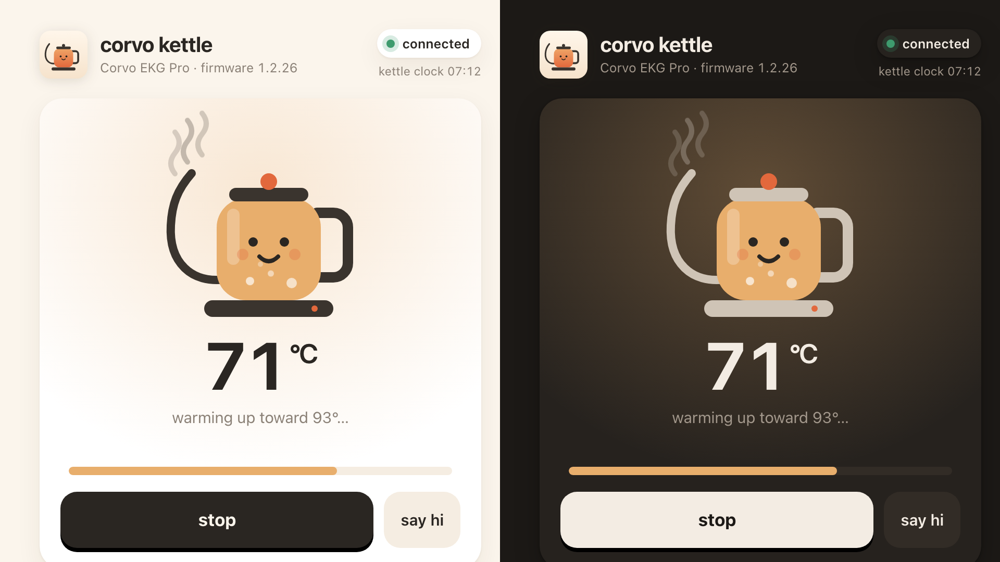
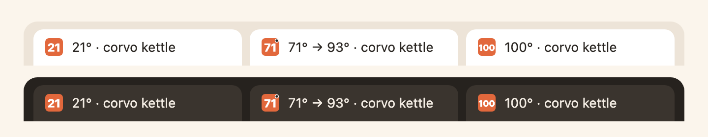
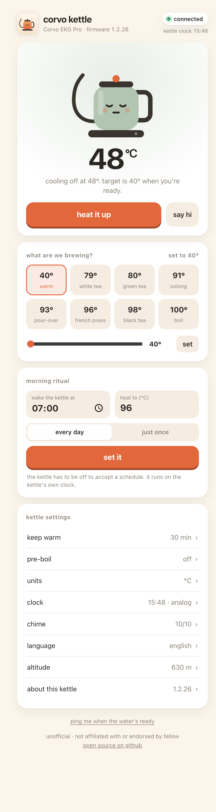

<p align="center"></p>

<h1 align="center">Unofficial Fellow Corvo Kettle</h1>

<p align="center">control your Fellow wifi kettle from your mac. locally. no cloud, no app, no account.</p>

<p align="center"></p>

---

i have a Fellow Corvo EKG Pro. it has wifi. it also has an app that wanted me to go through the cloud to boil water two meters from my desk.

turns out the kettle runs a small web server on your home network. so i spent an afternoon with Claude finding it, reading what it says, and building the thing i actually wanted: a friendly panel on my mac, a menu-bar control, and a `kettle` command for the terminal.

simple systems that breathe. this is one.

## what you get

- **a control panel** at `localhost:8737`, opened from Spotlight like an app. a little kettle that sleeps when it's cold, wobbles while it heats and steams when it's ready.
- **brew presets** in one tap: warm, white tea, green tea, oolong, pour-over, french press, black tea, boil. or a slider for anything in between.
- **a morning schedule**: heat to 96° at 07:00, every day or just once.
- **every setting from the kettle's own menu**: keep-warm time, pre-boil, units, clock face, clock sync, chime volume, language, altitude.
- **model and firmware**, read straight from the kettle.
- **a live browser tab**: the tab icon shows the water temperature and the title follows along (`71° → 93° · corvo kettle`). pin the tab and you've got a tiny thermometer next to your work.
- **a menu-bar control** (via [SwiftBar](https://github.com/swiftbar/SwiftBar)) with live temperature.
- **a terminal command**: `kettle on`, `kettle set 93`, `kettle schedule 07:00 96 daily`, `kettle wait`.

<p align="center"></p>

<p align="center"></p>

## install

```bash
git clone https://github.com/webmyc/unofficial-fellow-corvo-kettle
cd unofficial-fellow-corvo-kettle
./install.sh
```

the installer finds your kettle on the network, installs everything under `~/.local`, starts the panel at login and adds **Unofficial Fellow Corvo Kettle** to Spotlight.

macOS will ask whether `python3` can find devices on your local network. **click allow.** that's the panel's background helper talking to the kettle.

options:

```bash
KETTLE_IP=192.168.1.50 ./install.sh          # skip discovery
KETTLE_MODEL="Stagg EKG Pro" ./install.sh    # label shown in the panel
./install.sh --no-menubar                    # skip SwiftBar
./uninstall.sh                               # remove it all (add --all to drop config)
```

needs macOS, python3 (comes with the command line tools) and `jq` (installed via homebrew if missing).

## what it works with

- **tested:** Fellow Corvo EKG Pro on firmware **1.2.26**. every control in this repo was changed on a real kettle, read back, and set back.
- **should work:** Fellow Stagg EKG Pro on firmware 1.1.x–1.2.x. it's the same wifi platform, and the protocol work this is built on was done on a Stagg.
- **won't work:** kettles without wifi (the older EKG+ is bluetooth only).

if you try it on another model or firmware, open an issue and tell me what happened.

## how it talks to the kettle

everything stays on your home network:

| what | how |
|---|---|
| live temperature and state | `GET /temp` returns json |
| settings (target, hold, pre-boil, units, clock, chime, language, altitude, schedule) | `GET` / `POST /api?…`, a 17-byte binary settings record |
| heat on/off, arming the schedule, beep | `GET /cli?cmd=…` (on firmware 1.2.x the commands still run, they just don't print anything) |
| model and firmware | the kettle's root page |

every settings write changes only the one field it's about. it then reads the settings back and only reports success if the kettle confirms. if something doesn't confirm, it tells you and **does not retry**. a kettle is a heater, so no guessing.

## things worth knowing

- **the kettle drops off wifi while it's boiling.** that's the kettle, not this app. the panel says so and reconnects when it's done.
- **reserve the kettle's ip in your router.** everything points at one address. if your router hands the kettle a new one, run `kettle find` again.
- **schedules run on the kettle's own clock.** the panel shows if it has drifted from your mac's. one click fixes it.
- **check there's water in it before heating from another room.** remote control makes this easy to forget.
- **the cli has no password.** anyone on your wifi can reach the kettle directly, with or without this app. the panel itself only listens on your mac and refuses requests from other websites.
- **firmware updates may change things.** Fellow can change or close these endpoints at any time.

## credits

the binary settings format, the schedule arming sequence and the firmware page parsing come from **[bramboe/stagg-ekg-plus-ha](https://github.com/bramboe/stagg-ekg-plus-ha)** by Bram Boersma (MIT). it's a much deeper Home Assistant integration, and if you run Home Assistant you probably want that instead. this repo is the "just a mac, no server" version.

built by [Mihai Dragomirescu](https://respira.cafe) with [Claude](https://claude.ai).

## disclaimer

this is an unofficial, independent project. it is **not affiliated with, endorsed by or supported by Fellow Industries**. "Fellow", "Corvo" and "Stagg" are trademarks of their owner and are used here only to say which kettles this works with. use at your own risk. it talks to undocumented interfaces, and the [license](LICENSE) comes with no warranty.
